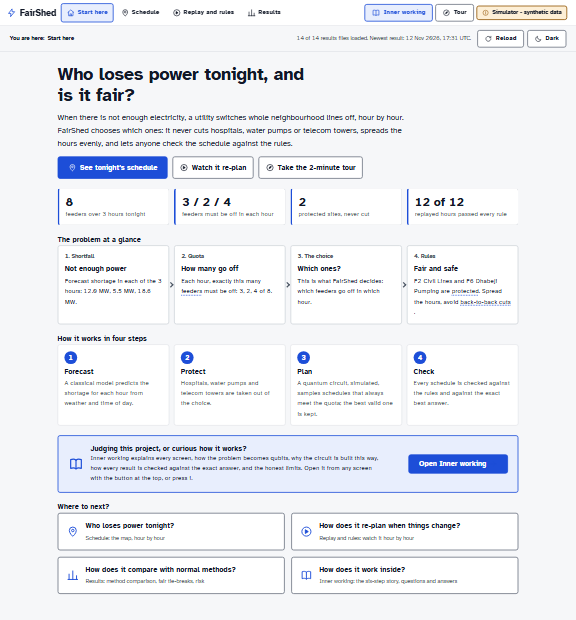
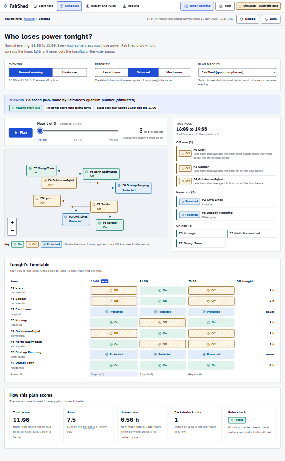
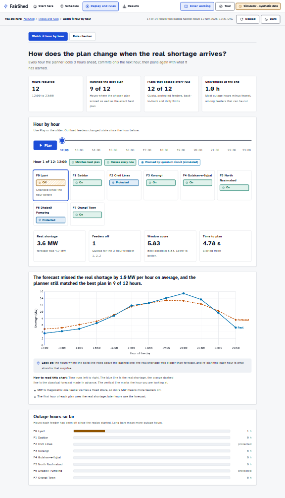
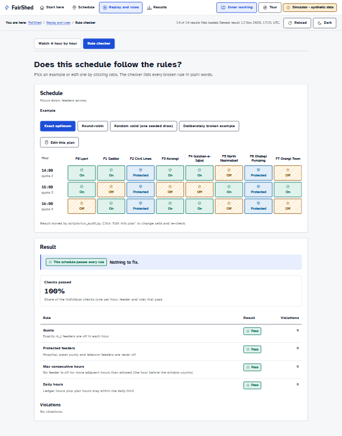
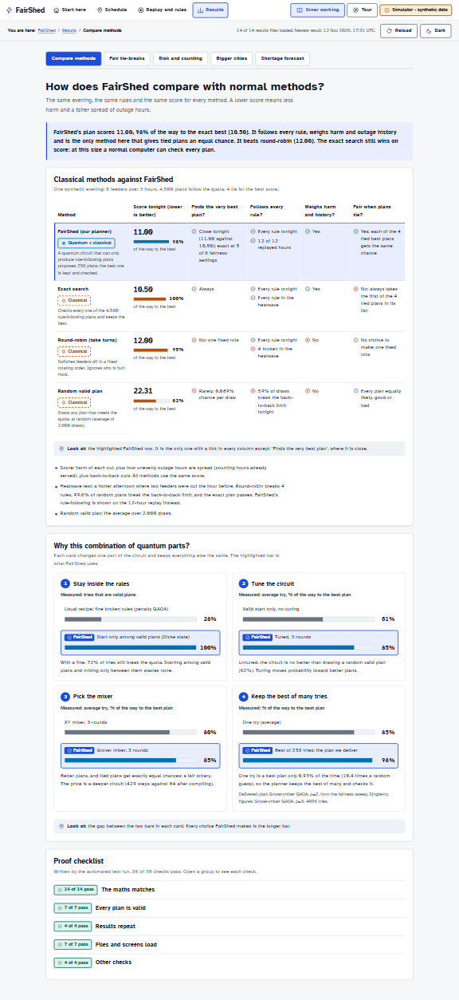
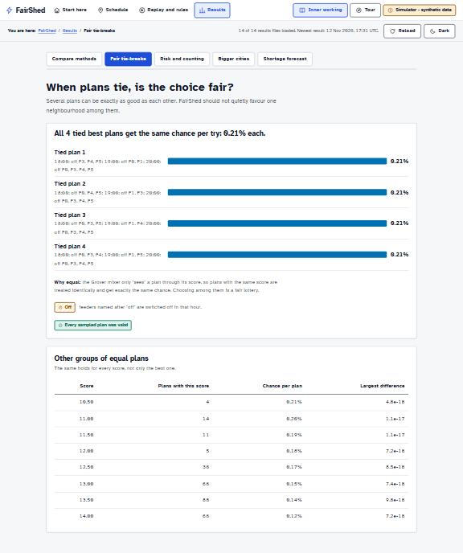
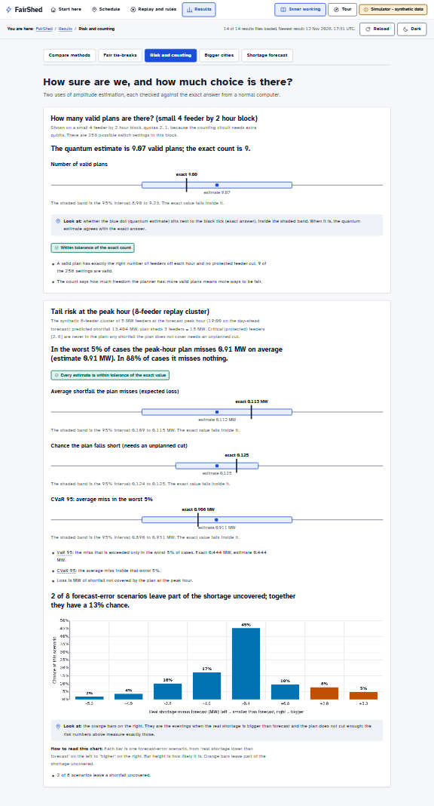
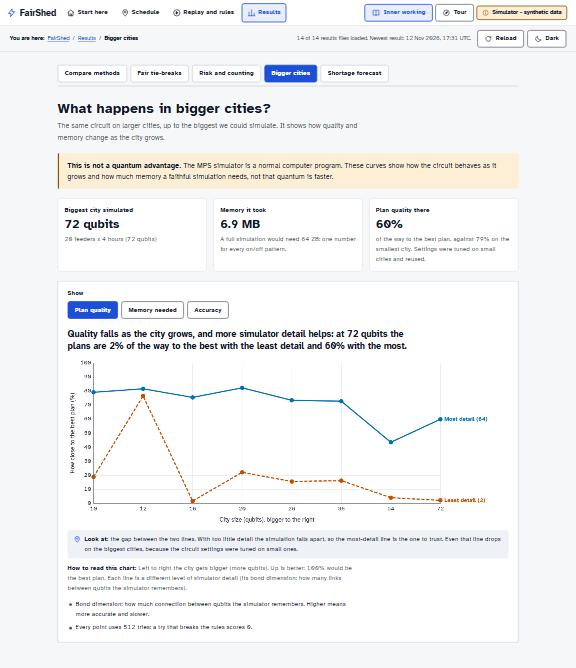
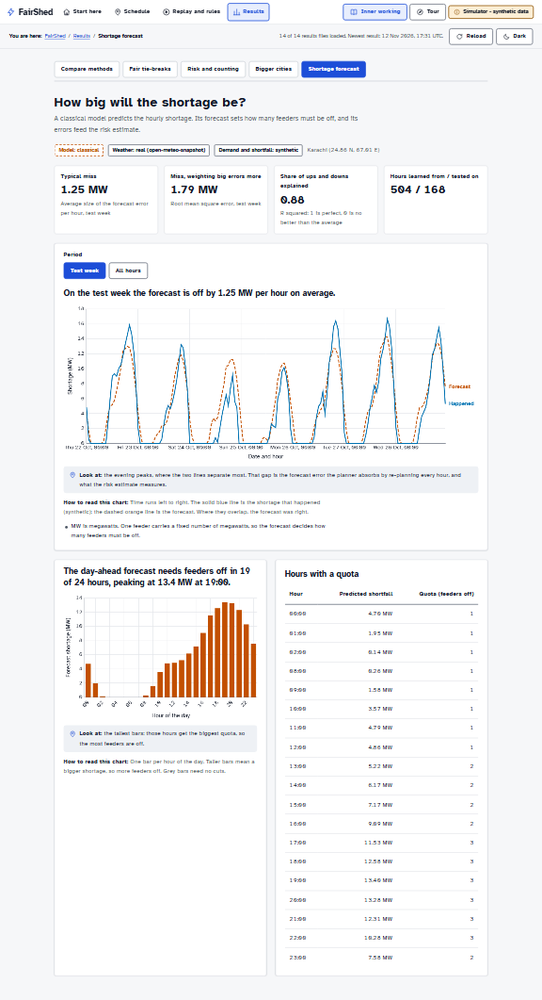
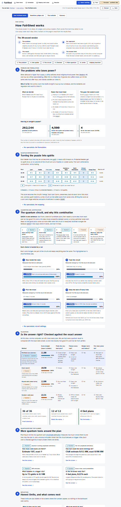

# FairShed dashboard guide

A walkthrough of every screen: the question it answers, how to read it, where the numbers to
remember are, and what to say when a judge asks about it. The dashboard is built for a desktop
browser (1440 x 900 or wider).

Numbers are not typed here. Every number on the dashboard is read from `results/*.json` when the
page loads. For the current values, open the screen or read `docs/TEAM_CHEATSHEET.md`, which is
generated from the same files (`node ui/tools/make_cheatsheet.mjs`).

Start it: `python scripts/tasks.py ui`, then open http://localhost:8000/ui/ (add `?tiles=off` when
offline). Screenshots below are in `media/screenshots/` and are regenerated with
`node scripts/ui_smoke.mjs --no-checks --full --out media/screenshots --scale 0.4`.

## How every screen works

The screens are built for the people who use the schedule. Every explanation sits behind one
button, **Inner working**, so the pages stay clean and a judge can open the detail on demand.

- **Top bar:** four sections (Start here, Schedule, Replay and rules, Results), the
  **Inner working** button, the Tour button and the permanent "Simulator - synthetic data" badge.
- **Inner working button** (or press `i`): opens a side panel about the screen behind it, in this
  order: one sentence, what you are looking at and how to read it, what to notice (built from the
  data), how it was made (each step tagged Quantum or Classical), what it does not show, the
  questions judges ask, and **For specialists** (qubit counts, formulas, every run, raw JSON).
  On wide screens it sits beside the page; Esc or Close shuts it.
- **Inner working pages** (linked at the top of the panel, not in the main navigation):
  - *How FairShed works*: the whole project in six steps (problem, into qubits, the circuit and
    why, checked against the exact answer, more quantum tools, honest limits), a 30-second
    version, how to reproduce, and a judging checklist mapped to the rubric.
  - *Questions judges ask*: 23 short answers in four groups, numbers read from the results.
  - *The methods*: every algorithm in five parts, marked "Part of the plan" or "Check or comparison".
  - *Glossary*: every technical word.
- **Status row:** "You are here", how many results files loaded and when the newest was written,
  Reload, and the light or dark theme.
- **Dotted-underlined words** open a glossary card (click, tap or Enter; Esc closes).
- **Charts:** each has a takeaway sentence as its title, a "Look at" line saying where to look
  first, and "How to read this chart".
- **Missing data:** a red banner names any missing or broken results file, and the affected panel
  says "Not available" instead of showing numbers.

## Start here

- **Question:** what is FairShed and where do I begin?
- **Read it:** the four boxes (shortfall, quota, the choice, rules), the four steps (forecast,
  protect, plan, check), then three findings written from the results files. Blue edge: the quantum
  part helps. Orange edge: where it loses.
- **Say to a judge:** "FairShed decides which neighbourhoods lose power each hour of a shortage,
  never cuts hospitals or water pumps, spreads the hours fairly, and checks every quantum result
  against the exact answer."

## Schedule: who loses power tonight?

- **Menu bar (top):** *Evening* (Normal evening, Heatwave), *Priority* (Least harm, Balanced,
  Most even: plans computed in advance along the harm and evenness trade-off) and *Plan made by*
  (FairShed, or the exact search, round-robin or a random plan for comparison). Nothing is
  re-optimised in the browser.
- **Showing line:** which plan is on screen, whether it follows every rule, how its score compares
  with taking turns, and the exact best score.
- **Hour control, map and "This hour":** Play or drag the slider. The map shows each area as On
  (teal, check), Off (amber, stripes, power icon) or Protected (blue, shield); the list beside it
  says who is off now and why, in one line each. Click an area for the full reason.
- **Tonight's timetable:** areas by hours, the way load-shedding schedules are published, with the
  hours each area is off tonight. Click a cell to jump to that hour and read why. Cells that break a
  rule are outlined in red and listed under the table (try Heatwave with round-robin).
- **Say to a judge:** "The quota comes from the forecast; the choice of which areas comes from the
  circuit, and we show when that choice is not the exact best one. Switch to Heatwave and
  round-robin to see the rules it breaks."

## Replay and rules: watch it hour by hour

- **Read it:** each frame is one hour. The planner solves the next three hours, keeps the first,
  then plans again. The solver chip says which method planned that hour; "Matches best plan" says
  whether it scored as well as the exact best plan.
- **Numbers to remember:** how many hours matched the best plan, and how many passed every rule.
  Cheatsheet row 8.
- **Say to a judge:** "This is receding-horizon re-planning with warm starts; where the circuit
  missed the best plan, the plan was still valid and we say so."

## Replay and rules: rule checker

- **Read it:** pick an example; red outlines mark broken rules. "Edit this plan" lets you click
  cells; Undo and Reset are next to it. The browser re-check uses the same four rules and score as
  `src/audit/rules.py`.
- **Say to a judge:** "Anyone can audit a published schedule. Round-robin breaks the back-to-back
  limit in the heatwave scenario; the exact plan passes."

## Results: compare methods

- **Read it:** the verdict box first. Then the table: four rows, the classical methods a utility
  could use (exact search, round-robin, a random valid plan) against FairShed's planner, on the
  same evening and the same score. Columns: score (and how close to the best), finds the very best
  plan, follows every rule, weighs harm and history, fair when plans tie.
- **Why this combination:** four cards, each changing one part of the circuit (valid-only start,
  tuning, mixer, best of many tries) with the separate runs as two bars. FairShed's choice is the
  highlighted bar. Every quantum variant, including Grover Adaptive Search, is listed under
  "For specialists" in the Inner working panel.
- **Numbers to remember:** cheatsheet rows 1 to 5 and 12.
- **Say to a judge:** "FairShed's plan gets 98% of the way to the exact best, follows every rule,
  and is the only method that gives tied plans an equal chance. The exact search still wins on
  score at this size, and we say so on the page."

## Results: fair tie-breaks

- **Read it:** each bar is one plan that ties for best; equal bars mean an equal chance.
- **Say to a judge:** "The Grover mixer sees a plan only through its score, so tied plans get
  exactly the same probability. Choosing among ties is a fair lottery, not circuit bias."

## Results: risk and counting

- **Read it:** on each ruler the black tick is the exact value, the blue dot the quantum estimate,
  and the band its 95% interval. Counting runs on a small 4 feeder by 2 hour block; risk on the
  8-feeder replay cluster. The bar chart gives each forecast-error scenario's chance in percent.
- **Numbers to remember:** cheatsheet rows 7 and 8.
- **Say to a judge:** "Amplitude estimation gives the right numbers here; at this size enumeration
  is easy, so this shows correctness, not speed."

## Results: bigger cities

- **Read it:** three tiles first (biggest city simulated, memory it took, plan quality there).
  The chart: left to right the city grows; up is closer to the best plan; one line keeps the most
  simulator detail (bond dimension), the other the least. "Memory needed" and "Accuracy" switch views.
- **Say to a judge:** "This is a classical simulation. It shows how much simulator memory the
  circuit needs as the city grows. It is not a quantum advantage."

## Results: shortage forecast

- **Read it:** blue is the shortage that happened (synthetic), orange dashed is the classical
  forecast. The day-ahead bars set the quotas.
- **Say to a judge:** "The forecast is classical ridge regression on real weather and synthetic
  demand."

## Inner working

- **How FairShed works:** the page to send a judge to. The 30-second version, then six numbered
  steps that follow the judging criteria: the problem and its rules, the switchboard picture of
  how feeder-hours become qubits, the circuit as a five-box pipeline with the four design-choice
  cards, the comparison table and proof tiles, the other quantum tools (counting, risk, bigger
  cities, fair ties), the honest limits and next steps, how to reproduce, and a judging checklist.
- **Questions judges ask:** grouped answers; "Open all" opens every one.
- **The methods:** twelve methods, each with the idea, an everyday example, its job here, where
  to see it, and its honest limit.
- **Glossary:** every term with a plain definition, an analogy and what it means in FairShed.

## Defending the honest limits

Simulator only. Synthetic feeders and demand (real weather snapshot). At this size a normal
computer finds the exact best plan, and it beats the circuit. Single tries rarely land on the best
plan, so the plan is the best of 256 tries. No speed-up is claimed anywhere on the dashboard.
