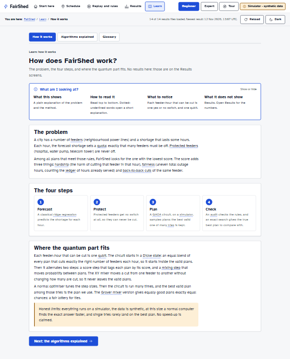

# FairShed dashboard guide

A walkthrough of every screen: the question it answers, how to read it, where the numbers to
remember are, and what to say when a judge asks about it. The dashboard is built for a desktop
browser (1440 x 900 or wider).

Numbers are not typed here. Every number on the dashboard is read from `results/*.json` when the
page loads. For the current values, open the screen or read `docs/TEAM_CHEATSHEET.md`, which is
generated from the same files (`node ui/tools/make_cheatsheet.mjs`).

Start it: `python scripts/tasks.py ui`, then open http://localhost:8000/ui/ (add `?tiles=off` when
offline). Screenshots below are in `media/screenshots/` and are regenerated with
`node scripts/ui_smoke.mjs --no-checks --full --out media/screenshots --scale 0.4`.

## How every screen works

- **Top bar:** five sections (Start here, Schedule, Replay and rules, Results, Learn), the
  Beginner and Expert switch, the Tour button and the permanent "Simulator - synthetic data" badge.
- **Status row:** "You are here", how many results files loaded and when the newest was written,
  Reload, and the light or dark theme.
- **"What am I looking at?"** on every screen: what it shows, how to read it, what to notice
  (built from the data), and what it does not show. Open on the first visit, then remembered.
- **Dotted-underlined words** open a glossary card (click, tap or Enter; Esc closes).
- **Beginner** shows plain explanations. **Expert** adds qubit counts, formulas, bitstrings,
  method notes and a raw JSON viewer.
- **Missing data:** a red banner names any missing or broken results file, and the affected panel
  says "Not available" instead of showing numbers.

## Start here

- **Question:** what is FairShed and where do I begin?
- **Read it:** the four boxes (shortfall, quota, the choice, rules), the four steps (forecast,
  protect, plan, check), then three findings written from the results files. Blue edge: the quantum
  part helps. Orange edge: where it loses.
- **Say to a judge:** "FairShed decides which neighbourhoods lose power each hour of a shortage,
  never cuts hospitals or water pumps, spreads the hours fairly, and checks every quantum result
  against the exact answer."

## Schedule: who loses power tonight?

- **Read it:** the map shows each feeder as On (teal, check), Off (amber, stripes, power icon) or
  Protected (blue, shield). Play or drag the slider to move through the hours. Click a feeder for
  "Off this hour because ...".
- **Fairness choice:** Least total harm, Balanced, Most even. It switches between plans computed
  in advance; nothing is re-optimised in the browser.
- **Numbers to remember:** the headline says how the plan compares with round-robin and whether it
  is the exact best plan for those weights. See the dashboard.
- **Say to a judge:** "The quota comes from the forecast; the choice of which feeders comes from
  the circuit, and we show when that choice is not the exact best one."

## Replay and rules: watch it hour by hour

- **Read it:** each frame is one hour. The planner solves the next three hours, keeps the first,
  then plans again. The solver chip says which method planned that hour; "Matches best plan" says
  whether it scored as well as the exact best plan.
- **Numbers to remember:** how many hours matched the best plan, and how many passed every rule.
  Cheatsheet row 8.
- **Say to a judge:** "This is receding-horizon re-planning with warm starts; where the circuit
  missed the best plan, the plan was still valid and we say so."

## Replay and rules: rule checker

- **Read it:** pick an example; red outlines mark broken rules. "Edit this plan" lets you click
  cells; Undo and Reset are next to it. The browser re-check uses the same four rules and score as
  `src/audit/rules.py`.
- **Say to a judge:** "Anyone can audit a published schedule. Round-robin breaks the back-to-back
  limit in the heatwave scenario; the exact plan passes."

## Results: scoreboard

- **Read it:** the summary box first. Then the table: valid tries, chance one try finds the best
  plan (next to the chance of a random guess), how close to best (0 to 100%), and verdicts computed
  from the data, including "Worse than the exact answer".
- **Numbers to remember:** cheatsheet rows 1 to 4. The proof checklist at the bottom groups the
  automated checks.
- **Say to a judge:** "The constraint-preserving circuits always give valid plans and beat random
  guessing, but they do not beat the exact answer, and round-robin's single plan scores higher
  than the average quantum try."

## Results: fair lottery

- **Read it:** each bar is one plan that ties for best; equal bars mean an equal chance.
- **Say to a judge:** "The Grover mixer sees a plan only through its score, so tied plans get
  exactly the same probability. Choosing among ties is a fair lottery, not circuit bias."

## Results: uncertainty and counting

- **Read it:** on each ruler the black tick is the exact value, the blue dot the quantum estimate,
  and the band its 95% interval. Counting runs on a small 4 feeder by 2 hour block; risk on the
  8-feeder replay cluster.
- **Numbers to remember:** cheatsheet rows 6 and 7.
- **Say to a judge:** "Amplitude estimation gives the right numbers here; at this size enumeration
  is easy, so this shows correctness, not speed."

## Results: bigger problems

- **Read it:** one line per problem size; left to right is more simulator memory (bond dimension);
  up is closer to the best plan.
- **Say to a judge:** "This is a classical simulation. It shows how much simulator memory the
  circuit needs as the city grows. It is not a quantum advantage."

## Results: shortage forecast

- **Read it:** blue is the shortage that happened (synthetic), orange dashed is the classical
  forecast. The day-ahead bars set the quotas.
- **Say to a judge:** "The forecast is classical ridge regression on real weather and synthetic
  demand."

## Learn

- **How it works:** the problem, the four steps, where the qubits come from.
- **Algorithms explained:** eleven methods, each with the idea, an everyday example, its job here,
  which numbers to look at, and its honest limit.
- **Glossary:** 32 terms with a plain definition, an analogy and what each means in FairShed.

## Defending the honest limits

Simulator only. Synthetic feeders and demand (real weather snapshot). At this size a normal
computer finds the exact best plan, and it beats the circuit. Single tries rarely land on the best
plan, so the plan is the best of 256 tries. No speed-up is claimed anywhere on the dashboard.
