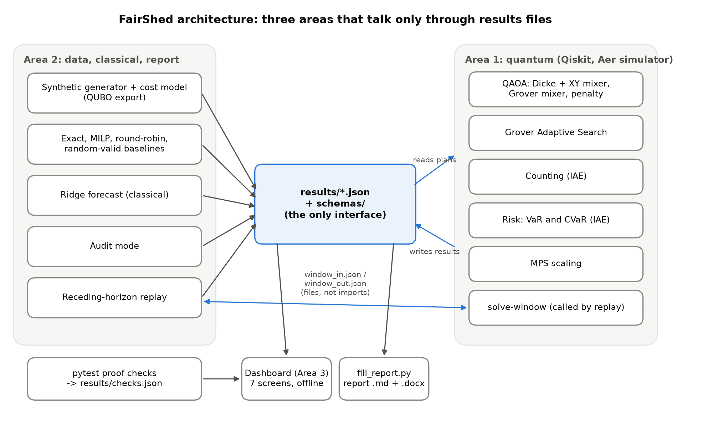
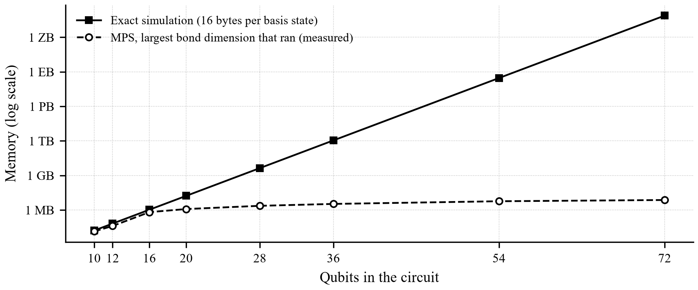

# FairShed: fair and auditable load-shedding with Qiskit

Team: Hello Child. Members: Raahim Babar, Zarrar Nadeem, Ahmed Ayan Arsalan. Domain: Energy and Smart Infrastructure.

Repository: https://github.com/cheesesocrates/Qiskit-Hack.

## 1. Summary

When there is not enough electricity, a utility switches whole [feeders](#g-feeder) (the power lines that supply one neighbourhood) off for an hour at a time. FairShed decides which feeders go off in each hour. Hospitals, water pumps and telecom towers are never cut, outage hours are shared fairly, and no area is cut hour after hour. We solve this optimisation problem with Qiskit quantum circuits, run on a [simulator](#g-simulator), that only ever produce [valid plans](#g-valid). Every quantum result is checked against an exact classical answer, and at this size the classical answer is better, so we claim no speed-up.

- **Every plan is valid.** Both [rule-preserving circuits](#g-rule-preserving) gave a valid plan in 100% of 4096 [tries](#g-shot); the standard [penalty circuit](#g-penalty-qaoa) managed only 27.9%.
- **A fair lottery.** The 4 tied best plans got equal chances (largest difference 4.8e-18).
- **Quantum estimates match exact values.** Counting valid plans: 9.07 against exactly 9. [Tail risk (CVaR)](#g-cvar): 0.911 MW against 0.906 MW.
- **Where quantum loses.** The best circuit gets 85% of the way to the best plan on average and finds it in 0.93% of single tries. Simple [round-robin](#g-round-robin) gets 95%; the [exact solver](#g-exact) gets 100%.

Table 1. Where to find each requirement.

| Requirement (hackathon brief) | Rubric line | Section |
|---|---|---|
| Identify the problem and its users | A. Problem validity | 2 |
| Formulate variables, objective, constraints, test instance | A. Problem validity | 2, 3 |
| Justify the quantum algorithm and the mapping | B. Quantum use | 3, 4 |
| Implement a working, reproducible Qiskit component | C. Implementation | 4, 9 |
| Evaluate against an exact reference | C. Validation | 6 |
| Reflect on correctness, limits and trade-offs | B. Awareness of limits | 8 |
| Architecture diagram | C. Implementation | 5 |
| Originality | D. Innovation | 7 |
| Website: the interactive dashboard | C. Outputs, E. Demonstration | 10 |
| Glossary of terms (linked from the text) | E. Presentation | 11 |

## 2. Problem statement

### 2.1 Context and users

Pakistan's power shortfall exceeded 4,000 MW in Oct 2026 with 3-4 hour cuts (source: [Dunya News, 6 October 2026](https://dunyanews.tv/en/Business/976376-electricity-shortfall-in-pakistan-exceeds-4000mw)). In Sept 2026 the regulator Nepra found K-Electric's outages on 620 feeders frequently exceeded its own limits and banned loss-based feeder cuts. A federal committee is reviewing a load-shedding exemption for telecom towers; express feeders already protect hospitals and water pumps.

- **Utility planner:** needs a cut schedule for the next hours that meets the shortfall.
- **Regulator or public:** need to check that a published schedule follows the rules.

### 2.2 Objective and rules

Objective: choose which feeders are off in each hour so the total cost (harm + unfairness + back-to-back cuts) is as low as possible.

- **Quota:** exactly the required number of feeders is off in each hour.
- **Protection:** hospitals, water pumps and telecom towers are never off.

### 2.3 Test instance

- 8 synthetic feeders on illustrative Karachi zones, 3 hours.
- Feeders off per hour: 3, 2, 4. Protected: feeder 2 (hospital), feeder 6 (water pump).
- 18 [qubits](#g-qubit); 4500 [valid plans](#g-valid) out of 262144 on/off patterns; 4 plans tie for the best cost (10.50).

### 2.4 How success is measured

Cost (lower is better), the share of tries that are valid plans, the [approximation ratio](#g-approx-ratio) (how close a plan is to the best one: 0 is the worst valid plan, 1 the best, invalid plans score 0) and the chance that one try ([one measurement](#g-shot)) is a best plan.

## 3. Formulation

- **Decision variables:** x[t][f] = 1 if feeder f is off in hour t, else 0.
- **Cost:** 1.0 x harm + 1.0 x unfairness + 2.0 x back-to-back cuts. Harm sums a per-feeder, per-hour score over the feeders that are off. Unfairness sums, over feeders, the squared gap between total outage hours (past + new) and the average. Back-to-back counts feeders off in two adjacent hours.
- **Hard rules:** the hourly quota and the protected feeders.

### 3.1 From plan to qubits

- One [qubit](#g-qubit) per (hour, feeder) switch, qubit q = t x N + f; protected feeders get no qubit, so they can never be switched off.
- The cost is a [QUBO](#g-qubo) (a quadratic function of 0/1 variables). Writing x = (1 - Z)/2 turns it into [Z and ZZ terms](#g-ising), which become [RZ and RZZ rotation gates](#g-rz).
- The quota is not a penalty: it is built into the circuit (Section 4).

## 4. Quantum approach and why

### 4.1 Key idea

We use [QAOA](#g-qaoa): a short quantum circuit that alternates a cost step and a mixing step, with its angles tuned by a classical optimiser. Each hour starts in a [Dicke state](#g-dicke), an equal mix of every way to switch off exactly the required number of feeders. The [mixer](#g-mixer) (the step that moves probability between plans) never changes how many feeders are off. So every measured plan is valid by construction. The standard [penalty version](#g-penalty-qaoa) only discourages invalid plans and wastes most of its tries on them.

Table 2. Quantum components.

| Component | What it does | Why this one |
|---|---|---|
| [[Dicke/dicke]] + [[XY mixer/mixer]] QAOA | Swaps which feeders are off, never how many | Rules hold in every sample |
| [[Grover mixer/grover_mixer]] QAOA | Treats all valid plans alike | Equal chances for tied plans; picks the dashboard and replay plans |
| [[Penalty QAOA/penalty_qaoa]] | Rules only as a cost penalty | Weak baseline |
| Counting ([[amplitude estimation/amplitude_estimation]]) | Estimates the share of valid plans | Planner freedom, checkable |
| [[Tail risk/cvar]] (amplitude estimation) | Estimates expected loss and CVaR from forecast errors | Exact check available |
| [[Grover Adaptive Search/gas]] | Repeated search for a better plan | Second method to compare |
| [[MPS/mps]] scaling | Same circuit, larger cities, compressed simulator | Behaviour beyond exact simulation |

### 4.2 Implementation and assumptions

Qiskit 2.6.2 circuits in src/quantum/ run with scripts/run_quantum.py on the Qiskit Aer 0.18.2 [simulator](#g-simulator). Assumptions: an ideal simulator (no noise, no hardware), results from a finite number of [measurements](#g-shot), angles tuned by the classical optimiser [COBYLA](#g-cobyla), and a plan is the best valid result of 256 measurements.

## 5. Architecture

Figure 1. Architecture: all parts exchange only JSON files.

How to read Figure 1:

- **Left, inputs:** a real weather snapshot and synthetic demand feed a classical [ridge regression](#g-ridge) forecast, which sets how many feeders must be off each hour. The instance and its cost ([QUBO](#g-qubo)) are then written out.
- **Centre, the hub:** every part reads and writes [JSON results files](#g-json), each checked against a schema. The quantum and classical code never call each other.
- **Right, quantum:** the Qiskit circuits read the instance and write their results back.
- **Bottom left, the answer key:** the [exact solver](#g-exact) and simple baselines write the reference every quantum number is compared with.
- **Top and bottom centre:** the [hour-by-hour replay](#g-replay) asks the quantum solver for each hour's plan through files and falls back to the exact solver; the rule checker, dashboard and report only read results.

## 6. Results against the classical reference

### 6.1 Base instance

Table 3. Base instance, 18 qubits. Circuits: 3 layers, 4096 measurements each.

| Method | Valid plans (%) | Chance one try is best | [[Approximation ratio/approx_ratio]] |
|---|---|---|---|
| [[Exact/exact]] (brute force; MILP agrees) | 100.0 | 1.0000 | 1.000 |
| [[Round-robin/round_robin]] (take turns) | 100.0 | 0.0000 | 0.952 |
| Random valid plan | 100.0 | 0.0000 | 0.619 |
| Dicke + XY mixer QAOA | 100.0 | 0.0059 | 0.798 |
| Grover mixer QAOA | 100.0 | 0.0093 | 0.846 |
| Penalty QAOA | 27.9 | 0.0002 | 0.183 |

Both rule-preserving circuits are always valid; the penalty circuit is valid in 27.9% of tries. On average quality, round-robin (0.952) and the exact solver (1.000) beat the best circuit (0.846).

How to compare: a random valid plan is a best plan 4 times in 4500 (0.09%), so the best circuit (0.93% per try) is about 10 times better than chance, but it still needs many tries. Round-robin scores well here because the base case allows 2 back-to-back hours: its plan passes every rule and costs 12.0 against the best 10.5. With a stricter limit it breaks the rules (Section 6.3).

### 6.2 Other quantum components

Table 4. Other quantum components against their exact value.

| Component | Quantum result | Exact value | Agrees |
|---|---|---|---|
| Counting (4x2 block) | 9.07 (8.90 to 9.23) | 9 | yes |
| Tail risk, CVaR 95% | 0.911 MW | 0.906 MW | yes |
| 4 tied best plans | spread 4.8e-18 | equal | yes |
| Grover search (4x2 block) | 90% valid, 30% best | 100% best | worse |
| Fairness-weight sweep | 5 of 6 at best cost | 6 of 6 | mostly |
| Replay (12 of 12 hours by circuit) | 9 best, 12 pass rules | 12 best | mostly |
| MPS scaling | 52 of 52 runs, up to 72 qubits | MILP | see 6.3 |

The [amplitude-estimation](#g-amplitude-estimation) results agree with the exact values; the search and planning results reach the best plan only part of the time.

Counting and tail risk are estimates, so each has an error bar; both exact values fall inside the stated tolerance (counting tolerance 1.0 plans). [Grover Adaptive Search](#g-gas) found a valid plan in 90% of its runs and the best plan in 30%; the exact solver always finds it. In the [replay](#g-replay) the circuit planned every hour it was asked to; in 3 of 12 hours its plan followed every rule but was not the cheapest.

### 6.3 Rules under stress and larger cities

Heatwave scenario (no feeder off more than 1 hour in a row): round-robin breaks the rules 4 times and 99.6% of random valid plans break the back-to-back limit. The exact plan passes every rule.

An [MPS (matrix product state)](#g-mps) simulator compresses the quantum state; the [bond dimension](#g-bond-dimension) sets how much it keeps. At 36 qubits, bond dimension 64 gave 98% valid plans (ratio 0.73) in 3.3 MB, where exact simulation needs 1.1 TB. At 72 qubits the best run (bond dimension 32) gave 99.8% valid plans (ratio 0.81) but bond dimension 64 gave 80%, so the result has not settled. [Fidelity](#g-fidelity) (overlap with the exact state) is measurable only up to 20 qubits: 0.94 at bond dimension 64. This is a classical simulation, not a quantum advantage.

Figure 2. Memory for exact simulation (computed) and for the MPS simulation (measured).

## 7. What is original

- **Fairness in the model:** past outage hours and back-to-back cuts count, and solutions with them are heavily penalized.
- **Rules in the circuit:** every sample is a valid plan, with no penalty tuning.
- **A fair lottery:** tied best plans get exactly equal chances ([Grover mixer](#g-grover-mixer)).
- **Audit and replay:** any schedule can be checked; the replay re-plans hourly with an exact fallback.

## 8. Limitations and trade-offs

- **Simulator and synthetic data:** an ideal, noise-free simulator, no hardware; feeders, demand and outage history are made up, only the weather snapshot is real.
- **Classical wins at this size:** the exact solver is better and faster; no speed-up is claimed.
- **Low single-try chance:** one try is a best plan only 0.93% of the time, so a plan is the best of 256 tries; this still missed the best plan at 1 of 6 fairness weights and 3 of 12 replay hours.
- **MPS limits:** Aer crashed on Windows on some circuits at bond dimension 2 or 4 (1 run retried); fidelity is measurable only up to 20 qubits; angles from small instances are reused; the largest instances do not settle.
- **Risk block:** 8 feeders, not 4 to 6, because smaller blocks have zero loss in every scenario.

## 9. Reproducibility

- Python 3.11, qiskit 2.6.2, qiskit-aer 0.18.2, qiskit-algorithms 0.4.0, qiskit-optimization 0.7.0 (requirements.txt); seed 7.
- Commands: python scripts/tasks.py setup, then test, demo and ui (the dashboard). Code and results: https://github.com/cheesesocrates/Qiskit-Hack.
- 36 of 36 proof checks pass (results/checks.json); scripts/validate_results.py checks every results file against its schema. Optimiser angles differ slightly between machines, so sampled counts reproduce on one machine.

## 10. Website

The interactive dashboard is online at [https://fairshed.vercel.app/](https://fairshed.vercel.app/). It reads the same [JSON results files](#g-json) as this report, so the numbers on screen match the numbers here.

- **Schedule:** the city map with each hour's plan; protected feeders always stay on.
- **Replay and rules:** the 12-hour [replay](#g-replay) hour by hour, and a rule checker that scores any schedule.
- **Results:** method comparison, fair tie-breaks, risk and counting, bigger cities ([MPS](#g-mps)) and the shortage forecast.
- **Inner working:** plain-language pages on how FairShed works and the methods.

The site replays plans computed in advance on the [simulator](#g-simulator); the quantum planner does not run in the browser. All data is synthetic.

## 11. Glossary

- **Amplitude estimation:** A quantum method that estimates a probability built into a circuit, such as the share of valid plans. We use the iterative version in Qiskit and check every estimate against the exact value.
- **Approximation ratio:** How close a plan is to the best one: 1 is the best valid plan, 0 the worst valid plan, and an invalid plan scores 0. A circuit's ratio is the average over its tries.
- **Bond dimension:** The setting that controls how much an [MPS](#g-mps) simulation keeps of the links ([entanglement](#g-entanglement)) between neighbouring qubits. Higher is more accurate, slower and uses more memory.
- **COBYLA:** A classical optimisation routine. It adjusts the circuit's angles step by step to lower the average cost of the plans the circuit produces.
- **Dicke state:** An equal mix of every way to switch on exactly k of n qubits. Here: every way to cut exactly the required number of feeders in one hour, all with the same weight.
- **Entanglement:** Quantum correlation between qubits. It is what makes a quantum state hard to store on a normal computer.
- **Exact solver (brute force, MILP):** Classical methods that are guaranteed to find the best plan. Brute force checks every valid plan; MILP (mixed-integer linear programming) is a standard solver used for the larger instances.
- **Feeder and express feeder:** A feeder is a power line that supplies one neighbourhood; load shedding switches whole feeders off. An express feeder is a dedicated line kept out of load shedding, used for hospitals and water pumps.
- **Fidelity:** How much a simulated quantum state overlaps the exact one: 1 means identical, 0 means nothing in common.
- **Grover Adaptive Search:** A quantum search method that repeatedly looks for a plan cheaper than the best one found so far.
- **Grover mixer:** A [mixer](#g-mixer) that treats every valid plan the same way, so plans with equal cost always get exactly equal probability: a fair lottery among tied plans.
- **Ising form (Z and ZZ terms):** The cost rewritten for qubits. Each 0/1 variable x is replaced by (1 - Z)/2, where Z is +1 or -1 depending on the qubit. Terms with one variable become Z terms; terms with a pair of variables become ZZ terms.
- **JSON results files and schemas:** Every part of the project writes its results to JSON files; a schema is a rule sheet that checks each file's structure before it is used.
- **Mixer (XY mixer):** The [QAOA](#g-qaoa) step that moves probability between plans. The XY mixer swaps which feeders are off within an hour, so the number of feeders off never changes.
- **MPS (matrix product state):** A way to simulate a quantum circuit on a normal computer by storing the state as a chain of small blocks, one per qubit, instead of one number per possible on/off pattern. It uses far less memory but becomes approximate when the [bond dimension](#g-bond-dimension) is capped.
- **Penalty QAOA:** The textbook version of [QAOA](#g-qaoa): the rules are only a cost penalty and a standard mixer is used, so the circuit can still produce invalid plans.
- **QAOA:** Quantum Approximate Optimisation Algorithm: a short circuit that alternates a cost step and a [mixer](#g-mixer) step. A classical optimiser tunes its angles; each measurement gives one candidate plan.
- **Qubit:** A quantum bit. Here each qubit is one yes/no switch: is this feeder off in this hour?
- **QUBO:** Quadratic unconstrained binary optimisation: a cost written as a sum of terms on 0/1 variables and on pairs of them. It is the standard input form for quantum optimisers.
- **Receding-horizon replay:** Re-planning every hour for the next three hours with the latest forecast, then committing only the first hour.
- **Ridge regression:** A simple classical forecasting model (a regularised straight-line fit). Here it predicts the electricity shortfall from weather and time of day.
- **Round-robin:** A simple take-turns rule that cuts feeders in a fixed rotation, with no optimisation.
- **Rule-preserving circuit:** A circuit built so that every measurement is a valid plan: it starts in a [Dicke state](#g-dicke) and uses an XY or [Grover mixer](#g-grover-mixer), which never change how many feeders are off.
- **RZ and RZZ gates:** Rotation gates that add a phase depending on one qubit (RZ) or on a pair of qubits (RZZ). They put the [Z and ZZ terms](#g-ising) of the cost into the circuit.
- **Shot (try, measurement):** One run of the circuit followed by a measurement, which gives one plan.
- **Simulator (Qiskit Aer):** A program on a normal computer that computes exactly what an ideal, noise-free quantum computer would do. No quantum hardware was used.
- **Tail risk (VaR and CVaR):** How bad the bad hours get. VaR 95% is the loss exceeded only 5% of the time; CVaR 95% is the average loss in that worst 5%. Here the loss is the shortfall (MW) that the plan does not cover.
- **Valid plan:** A plan that meets every hourly quota and never cuts a protected feeder.

