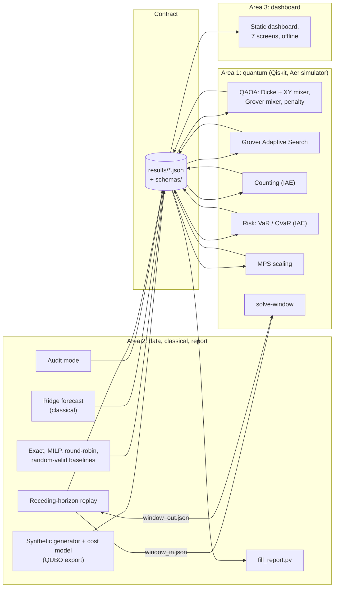
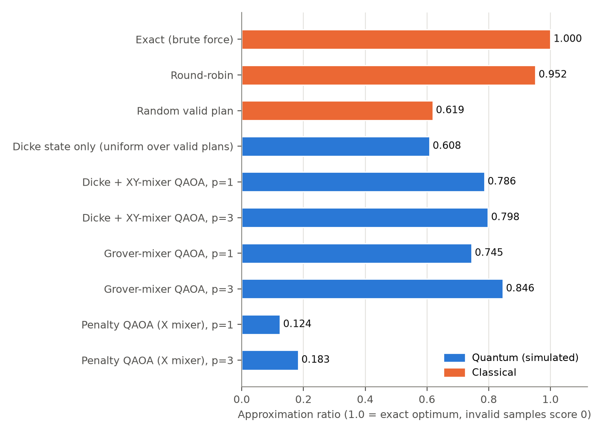
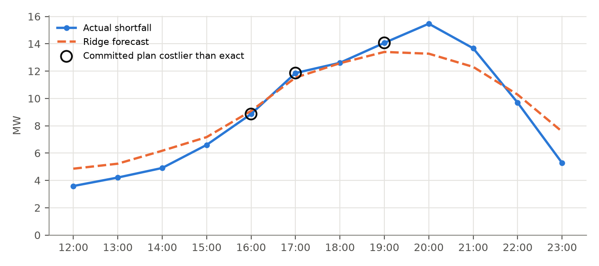
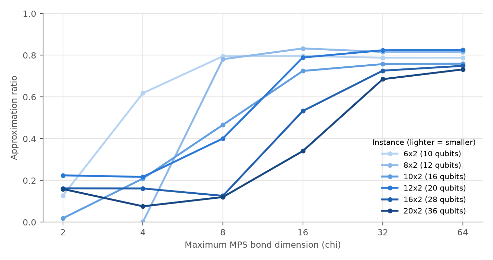

# FairShed: a fair, auditable load-shedding planner with Qiskit

Qiskit hackathon, Energy and Smart Infrastructure. Repository: https://github.com/cheesesocrates/Qiskit-Hack. Report generated 2026-11-12 12:53 UTC from commit b00251d by scripts/fill_report.py.

> Simulator only. Every feeder, demand figure and outage ledger in this report is synthetic, on illustrative Karachi zones. Weather in the forecast is a real Open-Meteo snapshot. No quantum speed-up is claimed: every instance here is also solved exactly by classical brute force or MILP, and that exact answer is the yardstick for every quantum number.

## 1. Problem

Context, quoted from the project brief (docs/SPEC.md); these are not results of this code: "Pakistan's power shortfall exceeded 4,000 MW in Oct 2026 with 3-4 hour cuts. In Sept 2026 the regulator Nepra found K-Electric's outages on 620 feeders frequently exceeded its own limits and banned loss-based feeder cuts. A federal committee is reviewing a load-shedding exemption for telecom towers; express feeders already protect hospitals and water pumps."

When supply falls short, a utility switches whole feeders off for an hour at a time. The quota (how many feeders go off each hour) follows from the shortfall. The open question is which feeders. A fair plan spreads the outage hours evenly, avoids cutting the same area hour after hour, spares the areas where an outage hurts most, and never cuts hospitals, water pumps or telecom towers. It must also be auditable: anyone should be able to check a published schedule against the rules.

Base instance: 8 synthetic feeders over 3 hours starting at 18:00, quotas 3, 2, 4, protected feeders F2 Civil Lines, F6 Dhabeji Pumping. It has 4500 valid plans; 4 tie for the optimum at cost 10.50 (worst valid plan 41.50).

### Formulation

Variable x[t,f] = 1 means feeder f is off in hour t; the qubit index is q = t*N + f. Hard constraints: exactly m_t feeders off in hour t, and protected feeders never off. The cost is a QUBO:

```
C(x) = w_h * sum_t,f hardship[t][f] x[t,f]
     + w_f * sum_f (ledger[f] + sum_t x[t,f] - mu)^2
     + w_c * (sum_f sum_t x[t,f] x[t+1,f] + sum_f prev_off[f] x[0,f])
```

Hardship weighs heat and population, the fairness term pulls every feeder's total outage hours (including hours already served, the ledger) towards the mean, and the consecutive term penalises cutting the same feeder in adjacent hours. Sums run over non-protected feeders. The exact contract is in docs/CONTRACT.md.

Weights in the base instance: hardship 1.0, fairness 1.0, consecutive 2.0.

## 2. Architecture

The repository is split into three areas that never import each other's code. They exchange only JSON files in results/, each validated against a JSON Schema in schemas/. Area 2 generates the synthetic instances, the exact reference, the forecast, the audit and the replay. Area 1 reads the QUBO from the plans files and runs every quantum stage on the Aer simulator. Area 3 is a static dashboard that reads the same files. The replay asks Area 1 to solve each window through files (window_in.json, window_out.json), and falls back to the exact solver per frame if needed.


*Figure 1. Architecture (Mermaid source: docs/report/architecture.mmd).*



## 3. Methods

- Dicke + XY-mixer QAOA: each hour block starts in a Dicke state (uniform over plans with exactly m_t feeders off) and an XY ring mixer keeps the Hamming weight, so every sample meets the quota and protected feeders have no qubit at all.
- Grover-mixer QAOA: reuses the Dicke preparation U_S and mixes with U_S (I - (1 - e^{-i beta}) |0><0|) U_S^dagger. Plans with equal cost always get equal amplitude, so a tie between optimal plans is broken by a fair lottery rather than by circuit bias.
- Penalty QAOA with the standard X mixer: the quota is a soft penalty; this is the weak baseline.
- Quantum counting: iterative amplitude estimation over a reversible validity oracle counts the valid plans (the planner's flexibility), checked against enumeration.
- Risk: the forecast's residual distribution is loaded into qubits and amplitude estimation gives expected loss, tail probability, VaR and CVaR of the shortfall a plan leaves uncovered.
- Grover Adaptive Search (qiskit-optimization GroverOptimizer) on an 8-variable block as a second quantum comparator.
- MPS scaling: the Dicke + XY circuit on larger instances (up to 36 qubits) with the Aer matrix product state simulator at bounded bond dimension, against the exact classical optimum.
- Classical side: brute force and MILP for the exact optimum, round-robin and uniform random valid plans as baselines, a ridge-regression shortfall forecast, an audit that scores any schedule against four rules, and a receding-horizon replay that re-plans every hour with a warm start.

Decision rule: when a QAOA run must produce one plan, it takes the lowest-cost valid sample among 256 shots; ties go to the plan closest to the previous one, then to a seeded draw.

## 4. Results

### 4.1 Quantum methods against the exact answer

All rows use the same instance and the same exact reference: 4500 valid plans, cost 10.50 to 41.50, 4 optimal. Approximation ratio is the mean over all samples with invalid samples scored 0, so infeasible output is penalised rather than filtered away. P(optimal) is the share of samples that are valid and optimal.

*Table 1. Ablation (results/ablation.json).*

| Method | Instance | Qubits | Layers | Shots | Feasible | P(optimal) | Approx. ratio | Fairness entropy | Runtime (s) |
|---|---|---|---|---|---|---|---|---|---|
| Exact (brute force) | base | n/a | n/a | n/a | 100.0% | 1.0000 | 1.000 | 0.994 | n/a |
| Round-robin | base | n/a | n/a | n/a | 100.0% | 0.0000 | 0.952 | 0.994 | n/a |
| Random valid plan | base | n/a | n/a | n/a | 100.0% | 0.0000 | 0.619 | 0.992 | n/a |
| Dicke state only (uniform over valid plans) | base | 18 | 0 | 4096 | 100.0% | 0.0022 | 0.608 | 0.992 | 0.20 |
| Dicke + XY-mixer QAOA, p=1 | base | 18 | 1 | 4096 | 100.0% | 0.0078 | 0.786 | 0.998 | 3.29 |
| Dicke + XY-mixer QAOA, p=3 | base | 18 | 3 | 4096 | 100.0% | 0.0059 | 0.798 | 0.997 | 5.05 |
| Grover-mixer QAOA, p=1 | base | 18 | 1 | 4096 | 100.0% | 0.0037 | 0.745 | 0.996 | 2.42 |
| Grover-mixer QAOA, p=3 | base | 18 | 3 | 4096 | 100.0% | 0.0093 | 0.846 | 0.998 | 14.30 |
| Penalty QAOA (X mixer), p=1 | base | 18 | 1 | 4096 | 19.6% | 0.0002 | 0.124 | 0.993 | 2.35 |
| Penalty QAOA (X mixer), p=3 | base | 18 | 3 | 4096 | 27.9% | 0.0002 | 0.183 | 0.993 | 4.55 |
| Exact (brute force) | block_4x2 | n/a | n/a | n/a | 100.0% | 1.0000 | 1.000 | 0.985 | n/a |
| Round-robin | block_4x2 | n/a | n/a | n/a | 100.0% | 0.0000 | 0.808 | 0.887 | n/a |
| Random valid plan | block_4x2 | n/a | n/a | n/a | 100.0% | 0.1070 | 0.602 | 0.887 | n/a |
| Grover-mixer QAOA, p=2 | block_4x2 | 6 | 2 | 1024 | 100.0% | 0.2383 | 0.833 | 0.938 | 0.55 |
| Grover Adaptive Search (GroverOptimizer) | block_4x2 | 16 | n/a | 20 | 90.0% | 0.3000 | 0.785 | 0.946 | 9.38 |



*Figure 2. Approximation ratio on the base instance.*

Best quantum row by approximation ratio: Grover-mixer QAOA, p=3 at 0.846. Highest sampled P(optimal): Grover-mixer QAOA, p=3 at 0.0093, against 0.0022 for sampling the Dicke state alone (uniform over valid plans). The single deterministic round-robin plan scores 0.952, higher than the mean QAOA sample; it is one plan, while the QAOA rows average over thousands of samples. A uniformly random valid plan averages 0.619. Penalty QAOA with the X mixer produces valid plans in only 19.6%, 27.9% of samples, which is why the constraint-preserving mixers matter. The honest reading: the constraint-preserving circuits always produce valid plans and shift probability towards cheap ones, but at 18 qubits the exact answer is instant classically, and per-shot P(optimal) stays at the percent level.

### 4.2 Fair lottery among tied optima

Grover-mixer QAOA, p=3 on 18 qubits. In the exact simulated state, plans with equal cost receive equal probability, so choosing among tied optimal plans is an unbiased lottery. All sampled plans valid: yes.

*Table 2. Equal-cost groups (results/lottery.json).*

| Plan cost | Plans with this cost | Least likely plan | Most likely plan | Spread |
|---|---|---|---|---|
| 10.50 | 4 | 0.00209998 | 0.00209998 | 4.8e-18 |
| 11.00 | 14 | 0.00201221 | 0.00201221 | 1.1e-17 |
| 11.50 | 11 | 0.00190665 | 0.00190665 | 1.1e-17 |
| 12.00 | 5 | 0.00178584 | 0.00178584 | 7.2e-18 |
| 12.50 | 36 | 0.00165265 | 0.00165265 | 8.5e-18 |
| 13.00 | 66 | 0.00151027 | 0.00151027 | 7.4e-18 |
| 13.50 | 88 | 0.001362 | 0.001362 | 9.8e-18 |
| 14.00 | 66 | 0.00121117 | 0.00121117 | 7.2e-18 |

### 4.3 Fairness trade-off (Pareto sweep)

Grover-mixer QAOA, p=2, re-optimised at each fairness weight and warm-started from the previous one. The chosen plan matches the exact optimum at 5 of 6 weights.

*Table 3. Pareto sweep (results/pareto.json).*

| Fairness weight | QAOA plan cost | Exact optimum | Matches exact | Std-dev of outage hours | Hardship | P(optimal) per shot |
|---|---|---|---|---|---|---|
| 0.00 | 9.000 | 9.000 | yes | 0.764 | 7.00 | 0.0131 |
| 0.25 | 9.375 | 9.375 | yes | 0.500 | 7.00 | 0.0062 |
| 0.50 | 9.750 | 9.750 | yes | 0.500 | 7.00 | 0.0059 |
| 1.00 | 11.000 | 10.500 | no | 0.500 | 7.50 | 0.0054 |
| 2.00 | 12.000 | 12.000 | yes | 0.500 | 7.00 | 0.0047 |
| 4.00 | 15.000 | 15.000 | yes | 0.500 | 7.00 | 0.0041 |

### 4.4 Counting the valid plans

*Table 4. Quantum counting (results/counting.json).*

| Quantity | Value |
|---|---|
| Block | 4 feeders x 2 hours, quotas 2, 1 |
| Search space | 256 |
| Exact count (enumeration) | 9 |
| IAE estimate | 9.067 |
| 95% confidence interval | 8.900 to 9.234 |
| Within tolerance | yes |
| Oracle queries | 4000 |
| Qubits (search / total) | 8 / 17 |

### 4.5 Tail risk by amplitude estimation

The synthetic 8-feeder cluster of 5 MW feeders at the forecast peak hour (19:00 on the day-ahead forecast): predicted shortfall 13.404 MW, plan sheds 3 feeders = 15 MW. Critical (protected) feeders [2, 6] are never in the plan; any shortfall the plan does not cover needs an unplanned cut. Loss unit: MW of shortfall not covered by the plan at the peak hour.

*Table 5. Risk (results/risk.json). 4 qubits, 29900 oracle queries, all within tolerance: yes.*

| Measure | Exact | Amplitude estimation | 95% interval |
|---|---|---|---|
| Expected loss (MW) | 0.1132 | 0.1120 | 0.1092 to 0.1147 |
| P(loss > 0) | 0.1250 | 0.1246 | 0.1238 to 0.1254 |
| VaR at 95% (MW) | 0.4443 | 0.4443 | found by search |
| CVaR at 95% (MW) | 0.9057 | 0.9107 | 0.8904 to 0.9313 |

### 4.6 Where round-robin and random plans fail

Afternoon heatwave, 14:00-17:00, 8 synthetic feeders x 3 hours, quotas 2, 3, 3. Hardship is very unequal across feeders and peaks at 15:00. A feeder may not be off two hours running (max_consecutive = 1). Feeders 0 and 1 (dense hot residential zones) were cut in the hour before the window and already have 4 outage hours on the ledger (daily limit 5). Round-robin from feeder 0 and random-valid plans both ignore this; the exact plan respects the cap.

*Table 6. Scenario heatwave_cap (results/plans/heatwave_cap.json).*

| Plan | Cost | Approx. ratio | Audit passes | Violations |
|---|---|---|---|---|
| Exact optimum | 40.67 | 1.000 | yes | 0 |
| Round-robin | 121.17 | 0.698 | no | 4 |
| Random valid (one draw) | 99.17 | 0.780 | no | 2 |

Over 2000 uniform random valid plans, 99.6% break the consecutive-hour cap and the mean approximation ratio is 0.635.

*Table 7. Audit mode on scenario heatwave_cap (results/audit_example.json).*

| Schedule | Passes | Audit score | Violations |
|---|---|---|---|
| Exact optimum | yes | 100.0% | 0 |
| Round-robin | no | 81.0% | 4 |
| Random valid (one seeded draw) | no | 90.5% | 2 |
| Deliberately broken example | no | 66.7% | 7 |

### 4.7 Receding-horizon replay with the quantum window solver

Solver requested: quantum. 12 hourly frames; 9 of 12 committed windows match the exact optimum; 48 feeder state changes; total hardship 32.0; fairness spread 1.0 hours. Solvers used: quantum (Grover-mixer QAOA, p=2, best of 256 shots): 12 frames.

*Table 8. Replay frames (results/replay.json).*

| Hour | Actual MW | Forecast MW | Quota | Window cost | Exact cost | Matches | Audit |
|---|---|---|---|---|---|---|---|
| 12:00 | 3.59 | 4.86 | 1 | 5.83 | 5.83 | yes | pass |
| 13:00 | 4.21 | 5.22 | 1 | 6.50 | 6.50 | yes | pass |
| 14:00 | 4.91 | 6.17 | 1 | 7.83 | 7.83 | yes | pass |
| 15:00 | 6.60 | 7.17 | 2 | 10.83 | 10.83 | yes | pass |
| 16:00 | 8.86 | 9.09 | 2 | 13.83 | 12.83 | no | pass |
| 17:00 | 11.86 | 11.53 | 3 | 16.83 | 14.83 | no | pass |
| 18:00 | 12.61 | 12.58 | 3 | 13.33 | 13.33 | yes | pass |
| 19:00 | 14.07 | 13.40 | 3 | 14.83 | 13.33 | no | pass |
| 20:00 | 15.47 | 13.28 | 4 | 16.33 | 16.33 | yes | pass |
| 21:00 | 13.67 | 12.31 | 3 | 12.33 | 12.33 | yes | pass |
| 22:00 | 9.69 | 10.28 | 2 | 5.83 | 5.83 | yes | pass |
| 23:00 | 5.28 | 7.58 | 2 | 4.83 | 4.83 | yes | pass |



*Figure 3. Replay: actual and forecast shortfall; circled frames committed a plan costlier than the exact optimum.*

### 4.8 Forecast (classical)

*Table 9. Forecast (results/forecast.json).*

| Quantity | Value |
|---|---|
| Model | ridge regression (closed form, numpy), alpha 1.0 |
| Training / test hours | 504 / 168 |
| MAE (MW) | 1.249 |
| RMSE (MW) | 1.793 |
| R squared | 0.875 |
| Weather | real (open-meteo-snapshot) |
| Demand and shortfall | synthetic |

## 5. Scale

Dicke + XY-mixer QAOA, p=2, Aer matrix_product_state simulator (default qubit layout). 39 of 40 points ran; 512 shots each. The matrix product state simulator is a classical method: this curve shows how much bond dimension a faithful simulation of the circuit needs as the instance grows, not a quantum advantage.

*Table 10. Approximation ratio by bond dimension (results/scaling.json).*

| Instance | Statevector | chi 2 | chi 4 | chi 8 | chi 16 | chi 32 | chi 64 |
|---|---|---|---|---|---|---|---|
| 6x2 (10 q) | 0.786 | 0.128 | 0.618 | 0.795 | 0.797 | 0.788 | 0.788 |
| 8x2 (12 q) | 0.813 | failed | 0.002 | 0.781 | 0.833 | 0.816 | 0.816 |
| 10x2 (16 q) | 0.751 | 0.019 | 0.209 | 0.466 | 0.725 | 0.758 | 0.760 |
| 12x2 (20 q) | 0.813 | 0.224 | 0.217 | 0.401 | 0.789 | 0.824 | 0.825 |
| 16x2 (28 q) | not run | 0.162 | 0.162 | 0.126 | 0.533 | 0.726 | 0.749 |
| 20x2 (36 q) | not run | 0.159 | 0.076 | 0.120 | 0.341 | 0.685 | 0.732 |

Angles: COBYLA from a small grid of linear-ramp starts (src.quantum.qaoa.QAOARunner.optimize) on the Aer statevector simulator, run on scale_6x2 (10 qubits) and scale_8x2 (12 qubits). candidate optimised on scale_6x2: mean exact approximation ratio 0.792; candidate optimised on scale_8x2: mean exact approximation ratio 0.804. Kept the candidate from scale_8x2. The p=2 angles gamma=[-1.1936, -0.7667], beta=[0.2614, 0.1694] were then fixed and transferred unchanged to every instance and bond dimension; there is no re-optimisation at larger sizes, so ratios on larger instances include transfer loss. The training instances are in-sample for the angles.



*Figure 4. Approximation ratio against bond dimension.*

## 6. Validation

30 of 30 proof checks pass in the last test run (results/checks.json, written 2026-11-12T12:48:03Z). Each is a pytest test.

*Table 11. Proof checks.*

| ID | Check | Passed | Detail |
|---|---|---|---|
| C01 | Cost model equals QUBO and Pauli forms on every bitstring | yes | 5376 bitstrings over 3 instances (8-12 variables), max /diff/ 1.8e-14 |
| C02 | Brute force over valid plans equals the minimum over all 2^n bitstrings filtered by validity | yes | 4x3_prevoff_protected: 27 valid of 4096; 5x2_prevoff_protected: 24 valid of 1024; block_4x2: 9 valid of 256 |
| C03 | MILP optimum equals brute-force optimum | yes | min and max agree with brute force on 10 instances (12-24 variables), all MILP plans valid |
| C04 | Round-robin and random-valid baselines always return valid plans | yes | 94 round-robin plans and 1350 random plans valid across 9 scenarios |
| C05 | Scenario heatwave_cap: round-robin and random fail the cap, the exact plan passes | yes | exact cost 40.67, audit passes; round-robin cost 121.17 (3.0x, approx ratio 0.70, 4 violations); random-valid breaks the cap in 99.6% of 200 |
| C06 | Fixed seed reproduces identical instance and plans | yes | 5 scenarios built twice with seed 7: instance and plans files identical after strip_volatile |
| C07 | Audit flags each of the four rules and passes a clean plan | yes | clean plan scores 100; each rule flagged alone (quota 1, protected 1, cap 1, daily 1); all-ones schedule trips 14 of 14 checks, score 0 |
| C08 | Base instance matches the spec: 8x3, quotas 3,2,4, feeders 2 and 6 protected | yes | 8x3, quotas [3, 2, 4], protected [2, 6], 24 variables (18 free), 4500 valid plans |
| C09 | Bit order: bits[t*N+f] equals matrix[t][f] | yes | 1000 (hour, feeder) cells checked across 9 scenarios; index q = t*N + f |
| C10 | Ridge forecast is reproducible and beats a mean predictor on the test set | yes | R2 0.875, MAE 1.25 MW vs 4.33 MW for a mean predictor on 168 held-out hours; two seed-7 runs identical |
| C11 | Forecast file states weather provenance and synthetic demand | yes | open-meteo-snapshot=real; synthetic-scenario-file=synthetic; open-meteo-snapshot=real; results/forecast.json: open-meteo-snapshot=real; dema |
| C12 | Replay commits a valid, quota-exact, protected-safe plan every hour | yes | 12 of 12 frames valid; quotas [1, 1, 1, 2, 2, 3, 3, 3, 4, 3, 2, 2]; protected feeders 2 and 6 never off; ledger_after equals the running sum |
| C13 | Replay falls back to exact when the quantum solver is unavailable or wrong | yes | 8 failure modes fell back to exact (no_such_script.py not found; command not found; invalid plan returned (quota or protected rule broken);  |
| C14 | Replay with a fixed seed reproduces identical frames | yes | 12 exact frames identical across two seed-7 runs; 3 fake-solver frames identical across two runs |
| Q01 | Quantum cost table and Ising form equal the contract cost on every bitstring | yes | 832 bitstrings over 3 instances: table = Ising = direct formula |
| Q02 | Dicke preparation gives uniform weight-m states | yes | 35 (n, k) pairs up to n=7, max amplitude error 1.7e-16; block product uniform over 27 valid plans |
| Q03 | Bit order: Qiskit count keys map to the right (hour, feeder) cell | yes | 9 single-qubit flips: key[n-1-c] -> bits[t*N+f] -> matrix[t][f], protected stay 0 |
| Q04 | Every sampled bitstring from the Dicke + XY-mixer circuit is a valid plan | yes | 6000 of 6000 samples valid at random angles; probability outside the valid subspace < 1e-12 |
| Q05 | Every sampled bitstring from the Grover-mixer circuit is a valid plan | yes | 6000 of 6000 samples valid at random angles; probability outside the valid subspace < 1e-12 |
| Q06 | Equal-cost plans get equal Grover-mixer amplitude | yes | 10 tie groups, max complex-amplitude difference 2.1e-16 (XY mixer on the same instance: probability spread 1.2e-01) |
| Q07 | Fixed seed reproduces QAOA angles and samples | yes | two runs: identical angles [-0.6918, 1.3242] and identical counts over 500 shots |
| Q08 | Penalty-QAOA objective equals cost plus quota penalty on every bitstring | yes | 64 bitstrings; at sample angles the X mixer leaves 94% probability on invalid plans |
| Q09 | Quantum-side reference equals the classical exact reference in plans/base.json | yes | 18 qubits for 24 variables; cost_min 10.5, cost_max 41.5, 4500 valid, 4 optimal: identical on both sides |
| Q10 | Quantum counting (IAE) of valid plans is within tolerance of exact enumeration | yes | 4x2: exact 9, estimate 9.07; 3x2: exact 9, estimate 9.01 |
| Q11 | Grover Adaptive Search returns plans scored with the true cost | yes | 2 runs: 100% valid, P(optimal) 1.00, best cost 4.666666666666668 vs exact 4.6667 |
| Q12 | Amplitude estimation of expected loss and tail probability matches the exact values | yes | E[L] exact 0.3000, estimate 0.2988; P(L>0) exact 0.2000, estimate 0.1993 |
| S01 | Committed schemas match schemas/build_schemas.py | yes | 13 schema files in sync |
| S02 | Every schema is valid and requires the five meta fields | yes | 12 schemas checked |
| S03 | All results JSON files validate against their schemas | yes | 20 files valid, 0 not generated yet |
| U01 | Every dashboard screen loads with no console errors (headless browser) | yes | 7 of 7 screens loaded with no console errors |

## 7. Honest limitations

- Simulator only. Nothing ran on quantum hardware, and there is no noise model.
- No speed-up claim. Every instance is also solved exactly by brute force or MILP; the quantum methods are measured against that exact answer, and the classical answer is better.
- Real feeder maps are not public, so the feeders are synthetic and placed on illustrative Karachi zones; nothing here describes a real network.
- Per-shot P(optimal) of the QAOA variants is at the percent level on the base instance; the plan comes from the best of 256 shots, which can still miss the optimum (see the Pareto and replay rows).
- All feeders, demand, supply, shortfall and ledger values are synthetic. Weather is real but only used as a forecast input.
- Counting and risk use 8 and 3 search qubits; they show that the estimators are correct, not that they are useful at this size.

Specific issues from docs/KNOWN_ISSUES.md:

*Table 12. Known issues.*

| Item | Status | Detail |
|---|---|---|
| MPS scaling, scale_8x2 at chi=2 | limit | One of 40 points: the Aer worker process crashed (Windows access violation) at bond dimension 2 on 12 qubits. Recorded as `failed` with no numbers; every other point ran. |
| MPS scaling, qubit layout | limit | The "interleaved" layout (same feeder on neighbouring sites) crashes Aer 0.18.2 on Windows at 16 qubits (exit 0xC0000409). The stage uses the default layout. |
| MPS memory pre-check | limit | Aer's MPS memory estimate is far too high (28 qubits: "57345 MB required"), so `max_memory_mb` is raised to 4 TB. Real use is bounded by the bond dimension; each point still runs in an isolated worker with a time limit. |
| Risk block size | limit | The spec asks for a 4-6 feeder block. The risk stage uses the 8-feeder replay cluster, because with 4-6 feeders the uncovered shortfall is zero in every residual scenario. The loss is the MW the peak-hour plan does not cover. |
| Pareto point at fairness weight 1.0 | limit | The QAOA decision rule (best valid of 256 shots) returns cost 11.0 where the exact optimum is 10.5. The other 5 weights match exact. Shown as "matches_exact: false". |
| Replay frames worse than exact | limit | 3 of 12 frames (16:00, 17:00, 19:00) commit a plan whose window cost is above the exact optimum. All 12 plans are valid and pass the audit. |
| Cross-machine reproducibility | limit | Fixed seeds reproduce results on one machine. COBYLA angles differ in the 4th decimal between machines (BLAS/OS), so sampled counts can differ slightly across machines. |
| GAS runtime on StatevectorSampler | limit | GroverOptimizer with qiskit's StatevectorSampler took 258 s for 10 runs. The stage uses the Aer sampler (9.4 s for 20 runs). |
| UI smoke test in CI | limit | `tests/ui/test_ui_smoke.py` needs Node 22+ and Chrome/Chromium/Edge. It skips (with the reason) when either is missing, so CI may report it as skipped. |
| Weather data | limit | Weather is a committed snapshot of the real Open-Meteo archive; demand, supply and shortfall are synthetic. `forecast.json` says so in `weather_provenance` and `demand_provenance`. |

## 8. Reproducibility

```
git clone https://github.com/cheesesocrates/Qiskit-Hack
cd Qiskit-Hack
python scripts/tasks.py setup      # .venv + pinned requirements
.venv/Scripts/python.exe scripts/tasks.py demo   # Windows; Linux/macOS: .venv/bin/python
.venv/Scripts/python.exe scripts/tasks.py test
.venv/Scripts/python.exe scripts/tasks.py ui   # http://localhost:8000/ui/
```

*Table 13. Versions used to build this report.*

| Package | Version |
|---|---|
| qiskit | 2.6.2 |
| qiskit-aer | 0.18.2 |
| qiskit-algorithms | 0.4.0 |
| qiskit-optimization | 0.7.0 |
| numpy | 2.4.6 |
| scipy | 1.17.1 |
| jsonschema | 4.26.0 |
| pytest | 9.2.0 |
| matplotlib | 3.11.2 |
| python-docx | 1.2.0 |
| Python | 3.11.9 |

Seeds: every results file records its seed (7 by default). Results reproduce exactly on one machine; optimiser angles can differ in the fourth decimal across machines.
